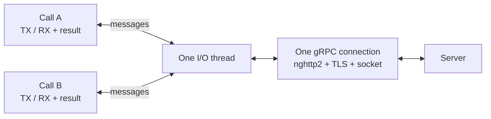
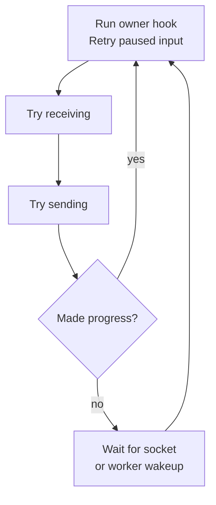
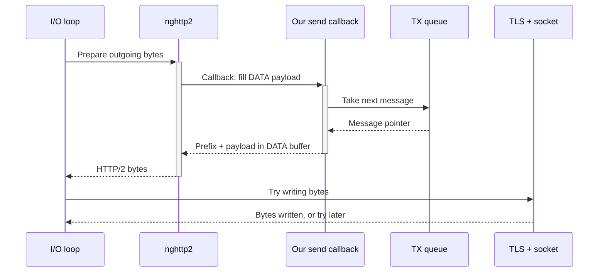
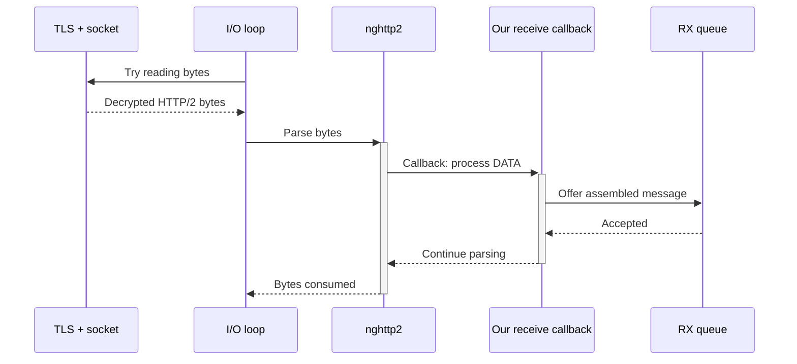
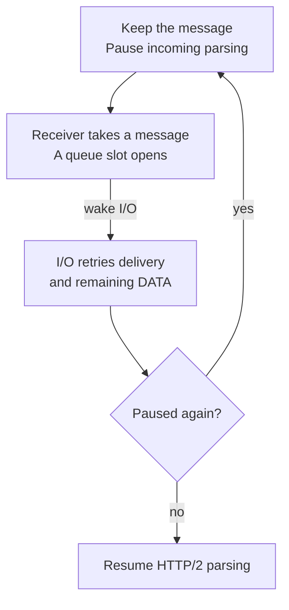
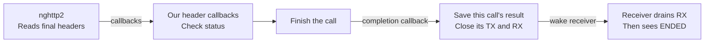

# Private network core

This core carries opaque messages over bidirectional gRPC calls. It does not
interpret Zerobus protobufs, acquire tokens, track acknowledgments, replay
records, or reconnect. Those responsibilities belong to the future sender,
receiver, and supervisor workers above `transport.h`.

One transport owns **one connection and one dedicated I/O thread**. Its calls
share that connection's nghttp2 session, TCP socket, and TLS session. Each call
has its own TX/RX queues, message state, and completion result. Only the I/O
thread accesses the gRPC wrapper after startup; multiplexing does not require
making the wrapper thread-safe. Sharing a thread between connections remains
outside this design. Each call is one RPC on a distinct HTTP/2 stream; calls
share the connection, not one gRPC message stream.

TLS settings live outside the transport: the caller supplies one shared
`zb_tls_ctx_t` to any number of connections. Each connection owns only its
`zb_tls_t` session. This lets the future SDK object load trust once and reuse
it across streams without sharing per-connection I/O state.

## Structure and data flow

Sending goes left to right; receiving goes right to left. Messages cross the
thread boundary through two queues. The I/O thread turns messages into wire
bytes and back.


TX is the outgoing queue; RX is the incoming queue. Each call has its own pair.
Transport API calls run on the calling worker, not another thread. The queues
transfer message pointers, not copies. The I/O box includes gRPC framing,
nghttp2, TLS and socket work;
none of those components is an additional worker. Explicit plaintext h2c
bypasses TLS. Different calls can have different sender/receiver workers:



Opening or cancelling a call is a control request to that same I/O owner, not
a direct wrapper call from a worker. Completing one call leaves its peers and
the connection running. A connection with no active calls can accept another.

The [I/O loop](#active-io-loop) shows when work runs. The separate
[send](#sending-nghttp2-asks-us-for-message-bytes),
[receive](#receiving-nghttp2-hands-us-message-bytes),
[pause/resume](#rx-full-pause-and-resume), and
[completion](#headers-trailers-and-completion) diagrams expand one job at a time.
Their labels describe the work; the tables below them locate it in code.

<details>
<summary>Files and ownership</summary>

`transport.c` owns calls, their channels/results, control requests and worker
synchronization. It starts and joins I/O. Each transport call embeds its gRPC
call directly; there is no intermediate I/O-call object.

`io.c` owns connection setup, resources and progress. It knows no call handles,
channels, pending call requests or results. It invokes three opaque hooks:
`service` at safe points, `on_ready` after connection setup, and `on_stopped`
after protocol and network teardown. Transport supplies these hooks. I/O does
not include `transport.h` or know the transport type.

`io.c` calls nghttp2 directly. `grpc.c` supplies passive session/call state and
callbacks; it does not run the thread or decide when to wait. nghttp2 handles HTTP/2
frames, header compression and flow control. Transport supplies the protocol's
per-call source/sink callbacks; gRPC knows only their function pointers and
opaque context, not channels or transport types. These callbacks and the
`service` hook execute on the I/O thread even though their code is in
`transport.c`.

| Component | Owns and does | Does not own or decide |
| --- | --- | --- |
| `transport.c` | Connection/call handles, per-call channels/results, call requests, worker synchronization, protocol adapters, thread start/join | Queue algorithms, socket/TLS progress, active byte-loop scheduling |
| `common/queue.c` | Fixed-capacity pointer ring: push, advance, pop, rewind | Blocking waits, message ownership, closure |
| `channel.c` | One slot-bounded lock-free ring, worker waits, ownership transfer, atomic closure | Byte budgets, offsets, readiness, RPC results, connection lifecycle |
| `io.c` | Connection resources/setup, per-connection TLS session, TCP/TLS progress, direct nghttp2 driving, readiness/wait decisions, byte cursors | Shared TLS context lifetime, call management, channels/results, worker synchronization, Zerobus policy |
| `grpc.c` | Session and call setup, per-stream callbacks, headers/trailers, completion, shared receive pause | Thread lifecycle, scheduling, socket waiting, queue implementation, Zerobus payload semantics |
| `grpc_utils.c` | Prefix framing, message decoding, status mapping, header checks | Session/call lifecycle, I/O scheduling |
| `tls.c` | Shared TLS settings, per-socket sessions, verified nonblocking TLS operations | Socket lifetime |
| `platform/network.c` | DNS, socket operations, coalesced wake pipe, readiness | Protocol or worker policy |

`message.h` holds only shared message, metadata, and RPC-result types; it has no
processing code. Transport receive-event types belong to `transport.h`.
`internal/platform/concurrency.h` supplies mutexes, semaphores, condition
variables, threads, and monotonic deadlines. `internal/common/` holds the
shared queue and utilities. Porting platform backends remains separate work.

</details>

## Active I/O loop

This is the established-connection loop, without setup or shutdown. Receiving
and sending are expanded separately below; each is a nonblocking attempt.



An empty call's TX queue does not prevent receiving or sending on another call.
When RX refuses a complete message, input pauses, but permitted writes can
still proceed. I/O uses the channel's immediate operations, so it never waits
for items or queue space; those take no lock.

| Diagram step | Code |
| --- | --- |
| Owner hook / retry | `io.c: zb_io_run()` drains the wake pipe and invokes `transport.c: service()` for control work; I/O then retries paused receive parsing |
| Try receiving | Socket/TLS read, then `nghttp2_session_mem_recv()` |
| Try sending | Copy frames from `nghttp2_session_mem_send()` into the 64-KiB output buffer, then socket/TLS write |
| Made progress? | Check whether bytes were read or written |
| Wait | `transport.c: prepare_wait()` arms worker wakeups; `platform/network.c: zb_net_wait()` watches the socket and shared wake pipe |

The diagram folds a short batch into one turn: the code attempts read then
write up to four times before rechecking wakeups/control. If all four passes
make progress, it repeats without sleeping; a pass with no progress leads to
the wait. Each turn probes the socket for input once even without a readiness
event, so window updates and acknowledgments are read while writes keep
making progress. nghttp2 schedules DATA for the connection's eligible streams. A
blocked operation is skipped until it is runnable; TLS can require
socket readiness in the opposite direction.

`service()` checks shutdown, executes pending call opens/cancels, and resumes
each active call's deferred TX provider. All call traversal belongs to
transport; I/O only observes the hook's connection-level status. The hook
returns before I/O advances nghttp2 or socket/TLS operations.

<details>
<summary>Wakeup, readiness and locking details</summary>

Three details explain why this loop can sleep without stalling a stream:

- **Worker wakeups:** before sleeping, I/O arms the wakeup of each TX whose
  DATA provider deferred on an empty queue, and of the RX that refused a
  message. A TX push or RX pop signals the shared wake pipe only while armed,
  so a busy I/O thread costs workers no syscalls. Arming and the worker's
  publication are ordered so that one of them always sees the other.
  Signal/drain coalesce notifications under the wakeup mutex. I/O drains
  before observing channel/control state. Close and control requests always
  wake I/O. Queued TX counts as work only while output can be sent: with a
  write waiting for the socket, I/O waits for writability instead.
- **Readiness:** a fresh operation can be attempted immediately. After a
  would-block result, it waits for the recorded direction. OpenSSL-buffered
  plaintext can make a read runnable without a socket event. TLS reads can
  require socket writability and TLS writes can require readability; I/O
  tracks these separately and gives the unfinished cross-direction operation
  priority.
- **Progress:** the four-iteration limit returns to wakeup/control checks
  even under sustained traffic. A turn that exhausts that limit continues
  without sleeping; a read/write iteration with no progress waits.
  Empty TX defers the DATA provider; HTTP/2 flow-control blockage waits for
  incoming window updates. Neither spins on an empty queue.

No control mutex is held across socket, TLS, or nghttp2 calls. Transport's mutex
protects control requests, readiness/termination and result publication, not
channel data operations. I/O has no control mutex or condition variable.
Lock order is control → wakeup, never the reverse. I/O never
waits for channel capacity/items; only workers use timed or infinite waits,
on each channel's own mutex and condition variable.

</details>

## Function and callback flow

nghttp2 knows HTTP/2 frames, not our message boundaries. When sending, it asks
our callback to fill a DATA payload. When receiving, it passes DATA payload
bytes to our callback, which assembles gRPC messages.

Read the send/receive diagrams from top to bottom: solid arrows are calls;
dashed arrows are returns. The calls all run on the I/O thread, including
callbacks and queue access. **A callback is a nested function call, not a
thread switch.** nghttp2 returns bytes to I/O; it does not write our socket.

<details>
<summary>How callbacks are registered</summary>

`grpc.c: zb_grpc_init()` registers the session callbacks;
`zb_grpc_call_open()` calls `queue_call()`, which supplies
`on_data_source_read` as that call's DATA provider.
nghttp2 invokes them inside `nghttp2_session_mem_send()` or
`nghttp2_session_mem_recv()`.

| nghttp2 event | Callback in `grpc.c` | Work performed |
| --- | --- | --- |
| Request DATA can be produced | `on_data_source_read` | Pull that call's messages, add gRPC prefixes, copy payload into native output |
| Response DATA arrives | `on_data_chunk` | Decode gRPC messages and deliver them through the configured sink |
| A response header arrives | `on_header` | Validate/store HTTP status, content type and gRPC trailer values |
| A frame finishes arriving | `on_frame_recv` | Interpret headers/trailers and END_STREAM for one call; apply GOAWAY to affected calls |
| A stream closes | `on_stream_close` | Complete the RPC if it has not already finished |
| A frame is serialized | `on_frame_send` | Detect a locally generated error GOAWAY; this is not proof of socket delivery |
| A queued frame cannot be sent | `on_frame_not_send` | Complete the RPC if its request HEADERS cannot be sent |

nghttp2's stream ID selects the call whose headers or DATA are being processed.
Each call keeps its own outgoing message, decoder, response headers, and result.
The session keeps the nghttp2 object, call list, connection failure, and receive
pause. Refusing a message pauses input for the whole session, including its other
calls. Per-call receive isolation is not implemented by this wrapper.

There is a second set of function pointers: `transport.c: zb_transport_call_open()`
configures the call's `pull_send`, `on_message`, and `on_complete` callbacks as
`transport.c: pull_send`, `message_received`, and `complete`.
Each callback receives the `zb_transport_call_t` directly as context, so it
accesses only that call's channels and result. These adapt the protocol to
channels and shared control. They do not re-enter the transport API.

</details>

### Sending: nghttp2 asks us for message bytes

Before this path runs, the sender calls `transport.c: zb_transport_send()`,
or `zb_transport_send_framed()` for a buffer from `zb_transport_buffer()` that
it filled with messages framed by `zb_transport_write_prefix()`. Either puts an
owned message into TX through `zb_channel_push()` and wakes I/O if armed.
Success means admission to the queue, not delivery or an acknowledgment.



| Diagram step | Code |
| --- | --- |
| Prepare outgoing bytes | `io.c: zb_io_run()` calls `nghttp2_session_mem_send()` |
| Fill DATA payload | nghttp2 calls `grpc.c: on_data_source_read()` |
| Take next message | The callback calls `transport.c: pull_send()` → `channel.c: zb_channel_try_pop(TX)` |
| Prefix + payload | `grpc_utils.c: zb_write_grpc_prefix()` prepares the five-byte prefix; `on_data_source_read()` copies prefix and payload directly into nghttp2's buffer |
| Try writing bytes | `tls.c: zb_tls_write()` → `SSL_write_ex()` → `socket_bio_write()` → `platform/network.c: zb_socket_write()` |

This shows one DATA-producing call. nghttp2 may instead return a control frame
or no output; it calls our DATA provider only when HTTP/2 flow control permits.
A message can span DATA-provider invocations, and one invocation can take
several messages from its call. The callback keeps its current message until
fully copied, then hands it to transport's `release_send()`, which frees it or
keeps a framed buffer for the sender's next `zb_transport_buffer()`. A framed
message is copied as is, without a prefix, so one TX message can carry many
gRPC messages, and a gRPC message may continue in the next one.

An empty, open TX defers the provider; on the next loop turn, transport's
`service()` hook re-enables it with `nghttp2_session_resume_data()` using that
call's stream ID. It does this for each active call; nghttp2 determines which
can produce DATA. A closed, drained TX supplies EOF.

I/O copies returned frames into its 64-KiB output buffer until it is full or
nghttp2 has nothing more, and writes from there, so TLS records are full-size
and small frames share a write. A write waiting for a TLS retry keeps its
bytes and length unchanged until it succeeds. Explicit h2c calls
`zb_socket_write()` directly, bypassing TLS.

### Receiving: nghttp2 hands us message bytes

This is the successful delivery path: I/O obtains decrypted bytes, nghttp2
extracts DATA, and our callback turns its payload into messages.



| Diagram step | Code |
| --- | --- |
| Try reading bytes | `tls.c: zb_tls_read()` → `SSL_read_ex()` → `socket_bio_read()` → `platform/network.c: zb_socket_read()` |
| Parse bytes | `io.c: zb_io_run()` calls `nghttp2_session_mem_recv()` |
| Process DATA | nghttp2 calls `grpc.c: on_data_chunk()` → `decode()` → `grpc_utils.c: zb_grpc_decoder_feed()`, which reads the prefix and assembles the payload |
| Offer assembled message | The callback calls `transport.c: message_received()` → `channel.c: zb_channel_try_push(RX)` |

Only complete messages enter RX. A message can span several reads/frames; one
input buffer can contain several messages. Partial messages stay in the decoder.
If RX refuses a completed message, the pause path below takes over.

On the receiver worker, `transport.c: zb_transport_recv()` calls
`zb_channel_pop(RX)` and lends the payload as a MESSAGE event until the next
receive. It then hands the message back to I/O, which frees one such message
per message it delivers, so allocation and free stay on one thread. The
receiver can run as soon as a message is queued; it need not wait for
`mem_recv()` to return. Explicit h2c reads directly with `zb_socket_read()`.

### RX full: pause and resume

When RX refuses a complete message, we keep that message and pause incoming
parsing. I/O does not block on the queue: other permitted I/O can still proceed.
The receiver opening a slot wakes I/O so it can retry. This receive pause is
connection-wide: it can delay delivery to other calls, although permitted
writes can still proceed.



| Diagram step | Code |
| --- | --- |
| Keep / pause | `grpc.c: on_data_chunk()` saves the unused DATA bytes and returns `NGHTTP2_ERR_PAUSE`; the decoder owns the complete message |
| A queue slot opens | `channel.c: zb_channel_pop(RX)` signals `zb_wakeup_signal()` after the pop |
| Retry delivery and remaining DATA | `grpc.c: zb_grpc_retry_receive()` re-enters `decode()`, including the same message-delivery callback |
| Resume HTTP/2 parsing | `io.c: zb_io_run()` calls `nghttp2_session_mem_recv()` on the remaining input |

The two resume steps have different jobs: our decoder finishes DATA already
handed to it, then nghttp2 continues parsing the rest of the input. Retry can
also happen on another loop turn while paused, not only after an RX wakeup.

<details>
<summary>Why the input buffer must stay unchanged while paused</summary>

nghttp2 has already counted the paused DATA chunk as consumed. Our callback
keeps a view of its unused bytes; feeding that chunk to nghttp2 again would
parse it twice. `zb_grpc_retry_receive()` retries the message and decodes those
saved bytes first.

Only once that pause clears does I/O resume nghttp2 on its separate input
suffix. This call is required even when the suffix is empty, to finish the
paused frame. The buffer can be overwritten only after the pause is clear and
the suffix is consumed.

</details>

### Headers, trailers and completion

Headers and trailers go through the same nghttp2 parser, but use callbacks
separate from DATA. Trailers carry the final gRPC status, not a payload message.
A normal server completion follows this path:



| Diagram step | Code |
| --- | --- |
| Read final headers | `io.c` calls `nghttp2_session_mem_recv()` |
| Check status | `grpc.c: on_header()` stores values; `on_frame_recv()` interprets the completed frame |
| Finish the call | `grpc.c: complete()`, sometimes through `close_call()`, which also resets its HTTP/2 stream |
| Save result / close queues | The callback calls `transport.c: complete()` with that call's context |
| Receiver sees ENDED | `transport.c: zb_transport_recv()` finds RX closed and empty, then reads the result under transport's mutex |

Stream-close and call-error callbacks also converge on completion. Queued
messages are still received before ENDED. Completing or cancelling one call
does not stop the connection or close another call's channels. A fatal
connection error or transport shutdown aborts all remaining calls.

`zb_io_init()` initializes gRPC before the creator starts the runner. On that
thread, transport's `service()` hook executes `zb_grpc_call_open()` and
`zb_grpc_call_cancel()` for control requests. I/O calls `zb_grpc_abort()` and
`zb_grpc_destroy()` on exit, then reports termination through `on_stopped`.
Call completion is therefore separate from connection termination.

## Two channel instances per call

Each `zb_channel_t` is a fixed ring of message pointers with one producer and
one consumer: sender → I/O for TX, I/O → receiver for RX. The producer owns the
tail index and the consumer the head index, each on its own cache line, so a
push or pop is one store with no lock. Popping transfers ownership and
immediately returns the slot. gRPC owns its current TX message until it
finishes copying it into native output or aborts.

| Direction / caller | Channel operation | Behavior |
| --- | --- | --- |
| TX / sender | `push` waits for space | Transfers the message; a full channel waits until half of it drained; wakes I/O if armed |
| TX / I/O | `try_pop` does not wait for an item | Transfers the message to gRPC; wakes a sender waiting for space |
| RX / I/O | `try_push` does not wait for space | Transfers a decoded message; wakes a waiting receiver |
| RX / receiver | `pop` waits for an item | Transfers the message; wakes I/O if armed to retry paused input |

The worker side sleeps on the channel's condition variable; a waiting bit tells
the other side to signal it. A side that finds the channel full or empty
publishes its waiting bit, then rechecks; the other side publishes its index,
then reads the bits. One of them always sees the other, so no wakeup is lost.
I/O never sleeps here; it arms a wakeup instead (see the I/O loop).

Capacity is fixed. The ring is rounded up to a power of two (at least four),
while the configured logical message limit is enforced exactly. A full TX
channel backpressures senders; a refused RX delivery pauses protocol input
instead of blocking the I/O thread.

Closing sets the flag and wakes the producer, consumer and I/O. Once closed,
pop drains the remaining queue. A closed, empty channel returns no message;
only `transport_recv` turns that into an ENDED event using the separate result.

The owner orders graceful closure after production: the sender half-closes TX
after its last send returns. RX publication and protocol completion both run
on the I/O thread. Cancellation may close TX while a send is running to wake a
blocked sender. A send already past the closed check may still transfer its
payload; cancellation does not guarantee delivery, and channel free releases
any unsent messages after all users have stopped.

## Buffering and copies

Backpressure is bounded: if RX refuses a completed message, the decoder retains
it and pauses HTTP/2 parsing and further application-input reads. Draining RX
wakes the I/O thread to retry delivery. Filling RX alone does not pause input:
the next message can still be assembled before its delivery is refused.
nghttp2 automatically updates receive windows as it processes DATA; the SDK
does not maintain a separate credit ledger or wait for a whole message before
returning credit. Messages larger than a window can finish assembling. Retained
application input is limited to I/O's 16-KiB buffer, alongside each call's
decoder message. Pausing application reads does not stop permitted TLS writes
from reading socket data for TLS protocol progress.

I/O retains the native output span until every byte is written, including
partial writes and TLS retries. gRPC borrows I/O's input buffer while
decoding is paused. There is no extra payload copy at either component boundary.
Inside the transport, each direction has these payload copies:

- TX: the DATA provider copies the owned message into nghttp2's native output,
  and I/O copies the frames into its output buffer.
- RX: the decoder copies DATA payload bytes into the owned receive message.

Channels transfer pointers. This count excludes OpenSSL's encryption/decryption and internal
buffers, and kernel buffering; it is not end-to-end zero-copy.

I/O embeds one `zb_grpc_t` session; each call handle has a `zb_grpc_call_t`.
Each call owns its active TX message and decoder; the session's pause state
protects borrowed input until both decoded DATA and nghttp2's parser have resumed. Resuming the
parser is necessary even with zero remaining bytes: a pause at the end of
DATA can leave frame completion pending.

## Worker-facing lifetime

`zb_transport_open(config, deadline, &transport)` creates a connection with no
calls. For TLS, the caller first creates a context with `zb_tls_ctx_new()` and
passes it as `config.tls_context`. The context is borrowed until open returns,
including on failure; transport never creates or frees it. Several opens may
share it concurrently. Explicit plaintext requires a NULL context; TLS requires
a non-NULL context, so forgetting one cannot silently disable TLS.

Open delegates connection preparation to `zb_io_init()`: DNS and gRPC session
initialization run on the creating caller. I/O copies the hostname for the
runner. After connecting TCP, the runner calls `zb_tls_new()` with that socket
and the borrowed context, then clears its context pointer and advances the
nonblocking handshake, waiting for socket readiness between attempts. Open
waits for TCP/TLS readiness, published before HTTP/2 network I/O, not server
acceptance of an RPC.

`zb_transport_call_open(transport, path, metadata, count, deadline, &call)`
allocates that call's channels and queues a request under transport's control
mutex, then signals I/O's wake pipe. Transport's `service()` hook opens the
HTTP/2 stream on the I/O thread. Only the owner calls into gRPC. The caller waits for an
acknowledgment, so borrowed path/metadata remain valid until the wrapper has
copied them. A deadline can remove a request that has not started; an already
executing request must acknowledge before return. The deadline bounds admission,
not the lifetime of an opened call. Call open does not wait for remote
acceptance; a remote rejection arrives through that call's `recv()`.

Cancellation uses the same owner-thread request path and waits until the owner
has detached the call's gRPC state. This acknowledgment is also what makes
individual call destruction safe: a freed call cannot remain in the owner's
protocol state or pending requests.

This pseudocode abbreviates application error handling. Sender and receiver run
concurrently: waiting until every send finishes before receiving can stall a
bounded bidirectional stream.

```text
SDK lifetime (future integration):
    tls_context = zb_tls_ctx_new(ca_file) // NULL ca_file uses system trust
    config.tls_context = tls_context     // shared by all SDK connections

Supervisor:
    transport = zb_transport_open(config, setup_deadline)
    call = zb_transport_call_open(transport, rpc_path, metadata, open_deadline)
    start sender(call) and receiver(call)
    // More calls can use this transport, each with its own sender/receiver.

Sender:
    for each encoded request:
        payload = malloc-owned encoded message
        if zb_transport_send(call, payload, size, admission_deadline) != OK:
            free(payload)                 // ownership did not transfer
            report failure and stop
    zb_transport_half_close(call)        // finite input only

Receiver:
    loop:
        event = zb_transport_recv(call, receive_deadline)
        if wait timed out: apply timeout policy; RPC remains active
        else if event.kind == MESSAGE:
            interpret message outside the core; data is lent until next recv
        else:
            report terminal status and stop

Supervisor, after completion or to stop this call:
    zb_transport_cancel(call)            // only if still active; peers continue
    join sender and receiver
    zb_transport_call_free(call)          // connection remains available

Supervisor, when finished with the connection:
    zb_transport_shutdown(transport)      // abort remaining calls; join I/O once
    join any remaining sender/receiver workers
    zb_transport_free(transport)          // also frees remaining call handles

SDK teardown, after its last connection:
    zb_tls_ctx_free(tls_context)
```

Send waits only for local admission, never a server acknowledgment. The sender
does not wait for an acknowledgment after each send.

Each call has one sequential sender, which half-closes only after its last send
returns, and one independent receiver. The channels remain SPSC even with many
calls: each has its own queue pair. Worker operations for different calls can
run concurrently without accessing the nghttp2 session.

Call cancel wakes its blocked workers and asks the owner to cancel only that
stream. Call free requires exclusive access to that handle after its workers
stop. It cancels/detaches if needed and frees queued messages and buffers kept
for reuse. gRPC releases its active TX message during completion/teardown.

Transport shutdown sets its stop flag and wakes I/O. The owner observes it
through `service()`, aborts remaining calls and releases network resources,
then `on_stopped()` publishes termination and acknowledges pending requests.
Transport joins its thread once. Channels and
results remain valid after shutdown so workers can drain accepted messages
and observe ENDED. Transport free requires exclusive access to the connection
and every remaining call, and frees remaining handles. Shutdown/free must not
race another shutdown/free; call open and worker send/receive/half-close/cancel
operations may overlap shutdown. Individual call free must not race operations
on that same call.

## Bounds and ownership

- Successful send transfers its malloc-owned payload; failure leaves it with
  the caller. The transport allocates a descriptor without copying the payload;
  a framed buffer carries its own. Each call keeps up to 32 sent framed buffers
  of `ZB_TRANSPORT_CHUNK` bytes for reuse.
- Each call's TX has at most N queued messages plus one owned by gRPC. Popping
  returns the queue slot; the engine later frees the message after copying its bytes
  into native output or discarding it. Neither step is delivery or an ACK.
- A MESSAGE event lends its payload to the receiver until its next receive.
  Empty messages may have NULL data but still consume descriptor capacity. Up
  to 256 returned messages per call wait for I/O to free them.
- Defaults: 16 MiB per message, 64 KiB per decoded header block, and 256 messages
  per queue. The ephemeral stream's sender opens TX with 16 slots of framed
  chunks of about 64 KiB each. Aggregate queue-byte limits and their configuration are deferred;
  retained payload memory scales with slot count and permitted message size.
- Each call's RX storage includes its bounded queue plus one
  assembling/undelivered message. The connection shares a 16-KiB I/O input
  buffer. Native nghttp2, OpenSSL, kernel buffers and
  descriptors add overhead; queue limits are not a process-memory limit.
- Queued receives precede ENDED, which repeats on subsequent receive calls.
  The first terminal result wins. Its optional `grpc_message` is borrowed until
  call free; the engine transfers that allocation directly to per-call control.
- The runner destroys gRPC state before its borrowed input buffer, TLS, and
  socket are released. Per-call control outlives that cleanup because protocol
  callbacks can still publish completion. Each call owns and frees its active
  TX message directly.

## TLS and platform boundary

TLS is the default: verified chain, matching DNS name or IP, TLS 1.2 or later,
and mandatory ALPN `h2`. DNS names use SNI; IP literals use IP identity verification.
A custom CA file replaces system roots. There is no verification bypass or TLS
failure fallback. Trust is loaded by the context owner before opening
connections, not by transport. Explicit `plaintext` selects h2c prior knowledge.

The current network backend uses Linux/POSIX APIs. Socket writes, including OpenSSL BIO writes,
suppress SIGPIPE without installing a process-global signal handler. Address
candidates are tried sequentially under one setup deadline. libc DNS is
synchronous and cannot be interrupted: the deadline is checked before/after
lookup but cannot bound the resolver syscall. Destruction does not wait for a
TLS close-notify exchange.

The TLS API separates `zb_tls_ctx_t` settings from `zb_tls_t` sessions.
The caller owns the context and may share it across connections and I/O threads;
each session borrows one socket and keeps its own handshake/read/write state.
Transport owns and frees only that per-connection session. Context creation and
trust loading belong to the future SDK object, whose integration is separate
work. OpenSSL retains the native context needed by each created session, so
the caller may free the context handle once all concurrent opens have returned,
even while their connections remain alive. Freeing it must not race an open.

Worker waits use a mutex and a monotonic condition variable through
`platform/concurrency.c`. Deadline conversion for readiness waits also lives
there; neither channels nor the network driver use GNU `sem_clockwait`.

## gRPC PR changes

Two:

1. `zb_message_t` has a `framed` flag, and `on_data_source_read()` copies a
   framed message without adding a prefix. It lets a sender pack many requests
   into one TX message, so the per-message allocation and handoff happen once
   per chunk instead of once per record.
2. An optional `release_send` callback takes back each sent message instead of
   freeing it, so transport can reuse framed buffers. Freeing them on I/O
   handed glibc memory back to the kernel and faulted it in again on the
   sender, in each chunk.

The multiplexing support is otherwise used as is: `queue_call()` and
`find_call()` dispatch by HTTP/2 stream, and each call's `config.context`
reaches its own `pull_send`, `release_send`, `on_message` and `on_complete`.

## Build and current integration status

From the repository root:

```sh
make -C purec build
```

Dependencies are pthreads, protobuf-c, nghttp2 >= 1.40, and OpenSSL >= 1.1.1,
located through CMake/pkg-config. Normal builds use committed protobuf bindings.
The workers in `internal/ephemeral_stream/` connect it to public ingestion and
recovery.

This effort combines the `purec-grpc` implementation at `66419da` with
`purec-network-platform` at `e246c2d` and that worktree's TLS implementation.
It includes their tests and adapts channels, the I/O loop, and transport to
those APIs. The gRPC baseline also supplies the current common/platform
layout, protobuf bindings, queue, and landing zone. Older draft HTTP/2 tests
target a superseded API and remain outside the build.

Run the imported offline suite with `make -C purec test`. Tests cover the
lower components; importing them alone does not establish end-to-end transport
interoperability or performance.
